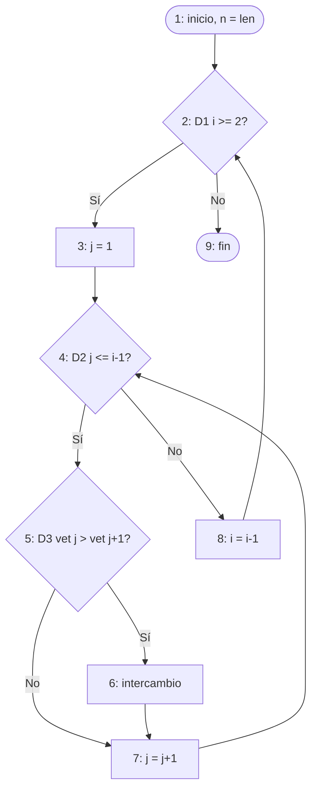

# Laboratorio 04 – xUnit y Cobertura de Código (Python)

Método probado: `bubbleSort` (ordena enteros en forma ascendente).


## 1. Grafo de flujo de control

Código analizado (`src/bubble_sort.py`), con los nodos del grafo marcados en los comentarios:

```python
def bubble_sort(self, vet):
    n = len(vet)                                   # nodo 1
    for i in range(n - 1, 0, -1):                  # nodo 2 (D1: ciclo externo)
        # nodo 3: inicia el ciclo interno
        for j in range(0, i):                      # nodo 4 (D2: ciclo interno)
            if vet[j] > vet[j + 1]:                # nodo 5 (D3: comparación)
                vet[j], vet[j + 1] = vet[j + 1], vet[j]   # nodo 6 (intercambio)
            # nodo 7: siguiente j
        # nodo 8: siguiente i
    return vet                                     # nodo 9
```

Nodos (numerados sobre el código):

| Nodo | Sentencia |
|------|-----------|
| 1 | `n = len(vet)`; inicio del `for i` |
| 2 | Decisión D1: ¿quedan iteraciones de `i`? (`i >= 2`) |
| 3 | Inicio del `for j` |
| 4 | Decisión D2: ¿quedan iteraciones de `j`? (`j <= i-1`) |
| 5 | Decisión D3: `vet[j] > vet[j+1]` |
| 6 | Intercambio (`aux`, swap) |
| 7 | Incremento de `j` (vuelve a 4) |
| 8 | Decremento de `i` (vuelve a 2) |
| 9 | Fin / `return` |



## 2. Complejidad ciclomática

- Fórmula por predicados: V(G) = P + 1 = 3 + 1 = **4** (D1, D2, D3)
- Fórmula por aristas y nodos: V(G) = A − N + 2 = 11 − 9 + 2 = **4**
  (aristas: 1-2, 2-3, 2-9, 3-4, 4-5, 4-8, 5-6, 5-7, 6-7, 7-4, 8-2)

## 3. Caminos independientes (decisiones + condición simple)

- **Camino 1:** 1-2-9 (no entra al ciclo externo)
- **Camino 2:** 1-2-3-4-5-7-4-8-2-9 (compara y no intercambia)
- **Camino 3:** 1-2-3-4-5-6-7-4-8-2-9 (compara e intercambia)
- **Camino 4:** 1-2-3-4-5-6-7-4-5-6-7-4-8-2-3-4-5-7-4-8-2-9 (el ciclo externo se repite: dos intercambios en la primera pasada y una segunda pasada sin intercambio)

## 4. Casos de prueba

| ID CP | Camino en el Grafo | Valores de Prueba | Resultado Esperado |
|-------|--------------------|-------------------|--------------------|
| CP1 | 1-2-9 | `[5]` | `[5]` |
| CP2 | 1-2-3-4-5-7-4-8-2-9 | `[1, 2]` | `[1, 2]` |
| CP3 | 1-2-3-4-5-6-7-4-8-2-9 | `[2, 1]` | `[1, 2]` |
| CP4 | 1-2-3-4-5-6-7-4-5-6-7-4-8-2-3-4-5-7-4-8-2-9 | `[3, 1, 2]` | `[1, 2, 3]` |

## 5. Cómo ejecutar

```bash
pip install -r requirements.txt

# Ejecutar pruebas
python -m unittest discover -s tests -v

# Cobertura (terminal + HTML en htmlcov/)
python -m coverage run --branch -m unittest discover -s tests
python -m coverage report -m
python -m coverage html
```
